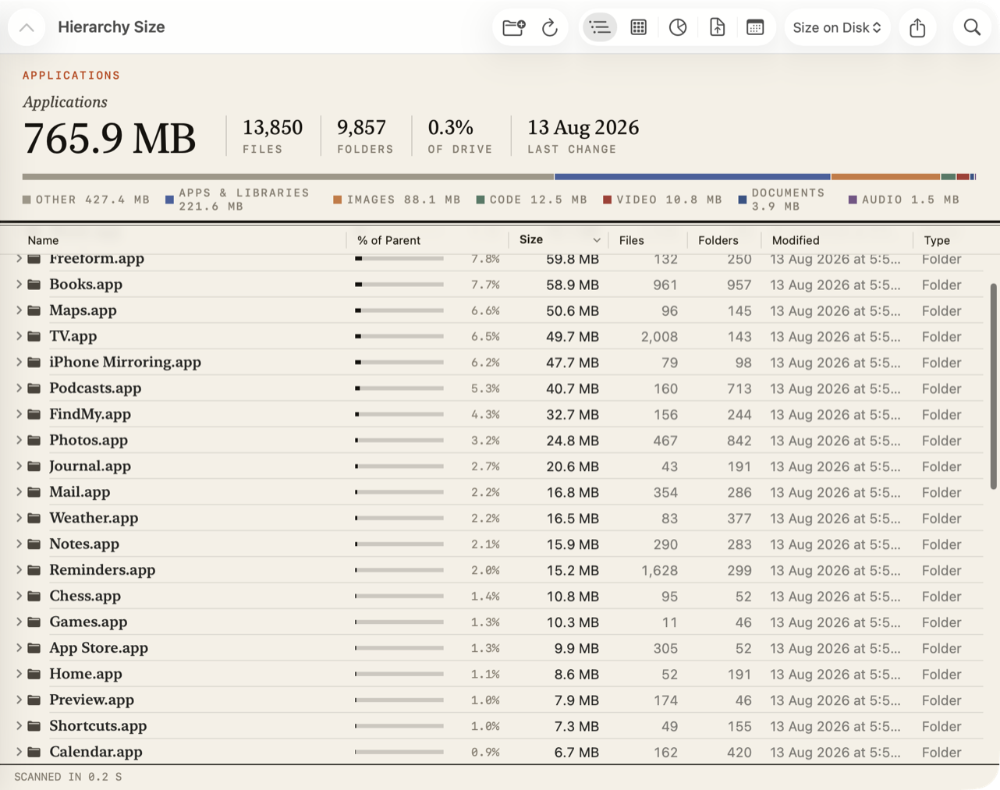
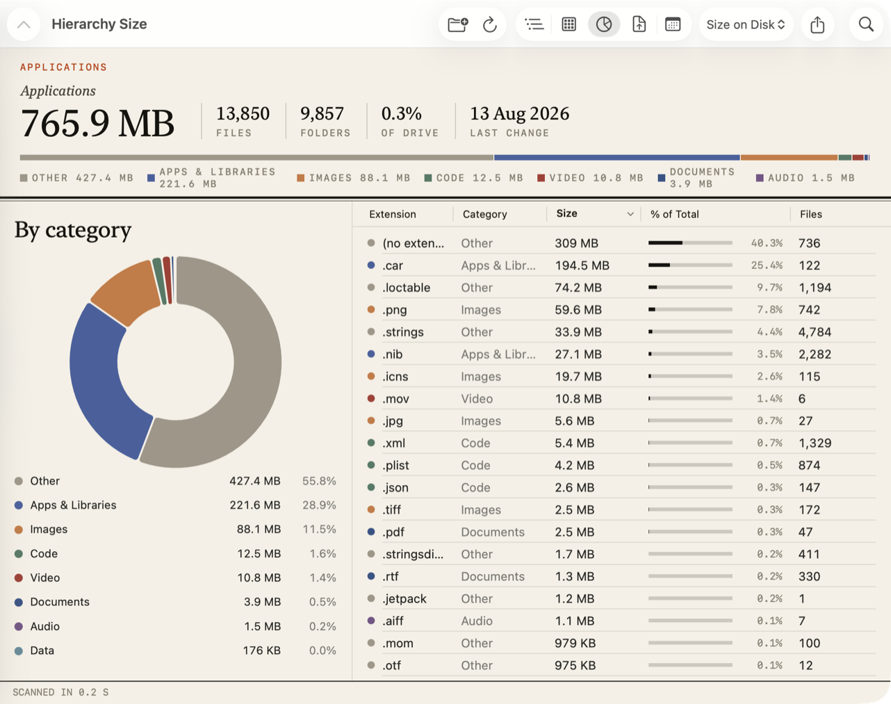

<p align="center">
  
</p>

<p align="center">
  <a href="../../releases/latest"></a>
  
  
</p>

<h3 align="center">“Your disk is almost full.” — Now you'll know why in seconds.</h3>

**Hierarchy Size** is a fast, native disk space analyzer for macOS. Point it at any folder or drive and it instantly shows you which folders and files are eating your storage — as a sortable tree, a colorful treemap, and clear charts. Find the culprits, clean up, and get your gigabytes back.

No subscriptions. No accounts. No tracking. Just answers.

---

## ✨ Why Hierarchy Size?

| | |
|---|---|
| ⚡ **Blazing fast** | Multi-threaded scanning walks hundreds of thousands of files in seconds. |
| 🌳 **The full hierarchy** | Every folder sorted by size, with a bar showing its share of its parent. Drill down as deep as you like. |
| 🟦 **Treemap at a glance** | Every file is a rectangle sized by how much space it takes. Big problems jump out instantly. Double-click to zoom in. |
| 🥧 **File types breakdown** | See how much space goes to videos, images, apps, archives, documents… down to each file extension. |
| 🏆 **Largest files list** | The 250 biggest files under the current folder, ready to reveal or remove. |
| 📅 **File age report** | Discover gigabytes of files you haven't touched in years. |
| 🔍 **Instant search** | Find any file or folder by name across the whole scan. |
| 🗑️ **Clean up safely** | Move items to the Trash right from the app — sizes update live, and everything stays recoverable. |
| 📤 **Export to CSV** | Take a full report to Excel, Numbers or Google Sheets. |
| 💾 **Drives overview** | Every mounted drive with used / free space at a glance. |
| 👻 **Hidden Space** | Finally see the space no other analyzer shows: snapshots, swap memory, system volumes, Preboot and mounted disk images. Delete Time Machine snapshots safely in one click. |
| 🧮 **Size on disk vs file size** | Switch between real allocated space and logical file size. |
| 🍎 **100% native** | Built with Swift & SwiftUI. Light, fast, and feels at home on your Mac — dark mode included. |

## 📸 Screenshots

**Tree view** — every folder, sorted by size



**Treemap** — see your whole disk at once


**File types** — what kind of data fills your drive



## 🚀 Get it

1. Download **Hierarchy-Size-1.1.1.zip** from the [latest release](../../releases/latest).
2. Unzip it and drag **Hierarchy Size** into your **Applications** folder.
3. The first time, **right-click the app → Open** (it isn't notarized by Apple yet).

> **Tip:** to scan protected places like Mail or other users' folders, give the app **Full Disk Access** in *System Settings → Privacy & Security → Full Disk Access*. The app shows a one-click shortcut if anything couldn't be read.

**Requirements:** macOS 14 Sonoma or later, Apple Silicon or Intel.

## ⌨️ Shortcuts

| Shortcut | Action |
|---|---|
| ⌘O | Scan a folder |
| ⌘R | Rescan |
| ⌘↑ | Go to the enclosing folder |
| ⌘⇧H | Hidden Space |
| ⌘1 – ⌘5 | Tree · Treemap · File Types · Largest Files · File Age |
| ⌘⌥R | Reveal selection in Finder |
| ⌘⌫ | Move selection to Trash |
| ⌘E | Export as CSV |

You can also drag any folder onto the window, or launch it from Terminal:

```bash
open -a "Hierarchy Size" --args ~/Downloads
```

## 🛠️ Build from source

Only the Xcode Command Line Tools are needed:

```bash
git clone https://github.com/mowshcashy/hierarchy-size.git
cd hierarchy-size
./build.sh
open "build/Hierarchy Size.app"
```

## 🔒 Privacy

Hierarchy Size runs entirely on your Mac. It never uploads, collects or sends anything — it has no network code at all.

---

<div dir="rtl">

## 🇸🇦 بالعربي

**Hierarchy Size** تطبيق ماك سريع يوريك وين راحت مساحة جهازك. اختر أي مجلد أو قرص، وخلال ثواني تشوف أكبر المجلدات والملفات بشجرة مرتبة، وخريطة ملونة، ورسوم بيانية واضحة.

- ⚡ مسح سريع جداً لآلاف الملفات
- 🌳 شجرة المجلدات مرتبة حسب الحجم مع نسبة كل مجلد
- 🟦 خريطة مربعات (Treemap) توضح الملفات الكبيرة فوراً
- 🥧 تحليل حسب نوع الملف: فيديو، صور، تطبيقات، أرشيف…
- 🏆 قائمة أكبر الملفات و📅 تقرير عمر الملفات
- 👻 المساحة المخفية: اللقطات، ذاكرة التبديل، أجزاء النظام وملفات الأقراص
- 🗑️ حذف آمن لسلة المهملات، وتصدير CSV
- 🔒 يشتغل على جهازك فقط، بدون إنترنت وبدون تتبّع

**التحميل:** نزّل الملف من [آخر إصدار](../../releases/latest)، انقل التطبيق لمجلد Applications، وأول مرة افتحه بكليك يمين ← Open.

</div>

---

<p align="center">Made with ❤️ for Mac users who are tired of “Storage Almost Full”.<br>If it helped you, give it a ⭐!</p>
