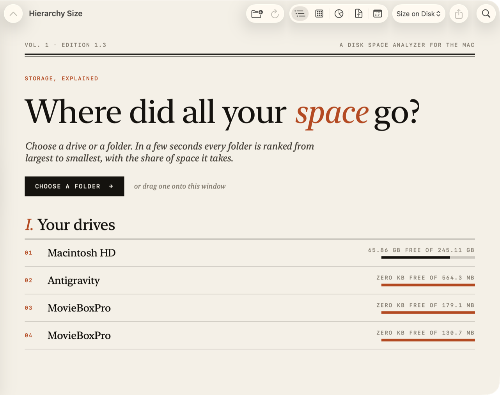
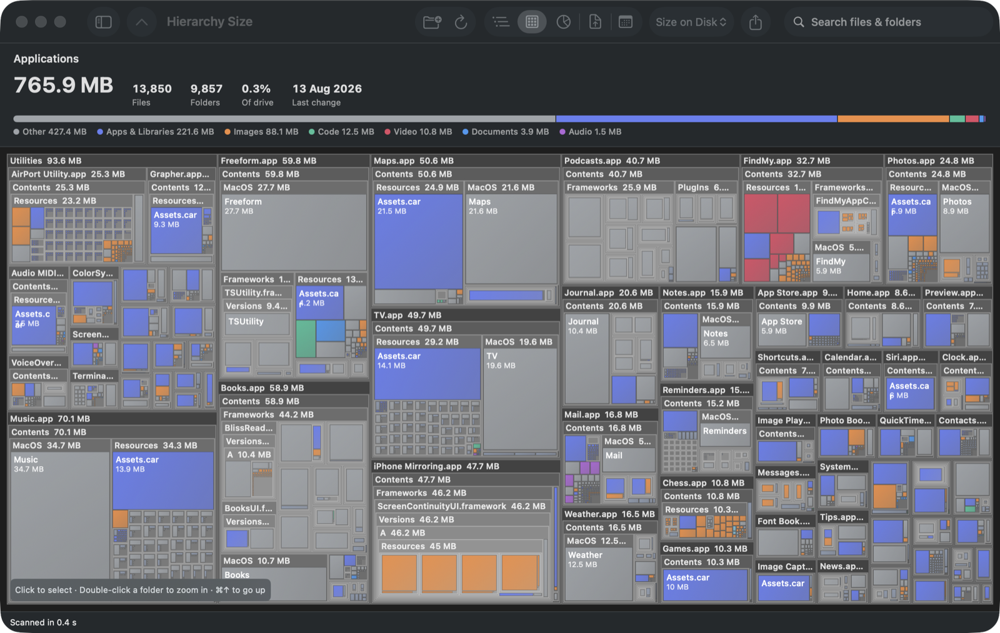

<p align="center">
  
</p>

<h1 align="center">Hierarchy Size: Free Disk Space Analyzer for Mac</h1>

<p align="center"><b>The free, open-source TreeSize alternative for macOS.</b> See what's taking up space on your Mac, find large files and folders, and free up storage in minutes.</p>

<p align="center">
  <a href="https://github.com/mowshcashy/hierarchy-size/releases/latest/download/Hierarchy-Size.zip"></a>
  <a href="https://mowshcashy.github.io/hierarchy-size/"></a>
  
  
</p>

---

## What is Hierarchy Size?

**Hierarchy Size is a free, open-source disk space analyzer for macOS.** It scans any folder or drive and shows which folders and files use the most storage, as a sorted folder tree, an interactive treemap and charts by file type and age. It also reveals space other tools miss, such as APFS snapshots, swap memory, system volumes and mounted disk images, and lets you delete what you don't need, safely.

- **Platform:** macOS 14 Sonoma or later, Apple Silicon and Intel (universal app)
- **Price:** free, MIT license, no ads, no account, no tracking
- **Language:** Swift and SwiftUI, 100% native
- **Use it for:** "Storage almost full" warnings, finding large files on Mac, cleaning caches, understanding "System Data"




## Features

| | |
|---|---|
| ⚡ **Fast scanning** | Multi-threaded scan reads hundreds of thousands of files in seconds. |
| 🌳 **Folder tree by size** | Every folder sorted largest first, with a bar showing its share of its parent. Expand as deep as you like. |
| 🟦 **Treemap** | Each file is a rectangle sized by the space it uses, so the biggest space hogs stand out instantly. Double-click to zoom. |
| 🥧 **File types** | Space by category (video, images, apps, archives, documents, code) and by every file extension. |
| 🏆 **Largest files** | The 250 biggest files in the current folder, ready to reveal in Finder or delete. |
| 📅 **File age** | Find gigabytes of files you haven't touched in years. |
| 👻 **Hidden Space** | See APFS snapshots, swap memory (VM), Preboot, Recovery, purgeable space and mounted disk images. Delete Time Machine local snapshots safely. |
| 🔐 **Run as Administrator** | Optional superuser mode to analyze and delete files owned by the system or other users. |
| 🗑️ **Safe cleanup** | Move to Trash, Delete Immediately, or Empty Trash right from the app. System folders are protected. |
| 🔍 **Search** | Find any file or folder by name across the whole scan. |
| 📤 **CSV export** | Export a full report to Excel, Numbers or Google Sheets. |
| 💾 **Drives overview** | Every mounted drive with used and free space. |
| 📰 **Editorial design** | A calm, print-inspired interface: serif headlines, paper tones, light and dark mode. |




## Download and install

1. **[Download Hierarchy-Size.zip](https://github.com/mowshcashy/hierarchy-size/releases/latest/download/Hierarchy-Size.zip)** (about 1.5 MB).
2. Unzip it and drag **Hierarchy Size** into your **Applications** folder.
3. The first time, **right-click the app › Open** (it isn't notarized by Apple yet).
4. Optional: give it **Full Disk Access** from the app's **Permissions** screen to scan everything.

Or build it yourself, with only the Xcode Command Line Tools:

```bash
git clone https://github.com/mowshcashy/hierarchy-size.git
cd hierarchy-size
./build.sh
open "build/Hierarchy Size.app"
```

## How it compares

| | Hierarchy Size | DaisyDisk | GrandPerspective | OmniDiskSweeper | TreeSize / WinDirStat |
|---|---|---|---|---|---|
| Runs on macOS | ✅ | ✅ | ✅ | ✅ | ❌ Windows only |
| Free | ✅ | ❌ Paid | ✅ | ✅ | Varies |
| Open source | ✅ MIT | ❌ | ✅ | ❌ | Varies |
| Sorted folder tree | ✅ | ✅ | ❌ | ✅ | ✅ |
| Treemap | ✅ | Sunburst | ✅ | ❌ | ✅ |
| File types and file age reports | ✅ | ❌ | ❌ | ❌ | Varies |
| Snapshots, swap and disk images | ✅ | Partly | ❌ | ❌ | ❌ |

## FAQ

### How do I see what is taking up space on my Mac?
Open Hierarchy Size and click **Macintosh HD** (or any folder). In a few seconds you'll see every folder sorted by size. Expand the biggest ones, or switch to **Treemap** to spot large files visually.

### Is there a TreeSize for Mac?
TreeSize and WinDirStat are Windows apps. **Hierarchy Size** brings the same idea to macOS: a folder tree sorted by size, percentages of the parent folder, file type reports, top files and CSV export, for free.

### What is "System Data" on Mac and how do I reduce it?
"System Data" usually includes caches, logs, APFS snapshots, swap memory, iOS simulator runtimes and app support files. Open **Go › Hidden Space** in Hierarchy Size to see snapshots, swap and disk images, then scan `~/Library/Caches` and `~/Library/Application Support` to find the rest.

### How do I find large files on my Mac?
Scan a folder, then open the **Largest Files** tab. It lists the 250 biggest files with their location. Right-click any file to reveal it in Finder or delete it.

### I deleted files but my free space didn't change. Why?
Deleted files stay in the Trash until it's emptied, and APFS snapshots can keep deleted data. Use **Empty** next to the Trash in the sidebar, or **Delete Immediately**, and check **Hidden Space** for snapshots.

### Is it safe to delete ~/Library/Caches?
Usually yes. Caches are rebuilt automatically. Quit the apps first, then delete their cache folders. Hierarchy Size blocks deleting top-level system folders.

### Is Hierarchy Size safe and private?
Yes. It runs only on your Mac, has no network code, collects nothing, and its full source code is in this repository.

### Does it work on Apple Silicon (M1, M2, M3, M4) and Intel Macs?
Yes. It's a universal app for macOS 14 Sonoma and later.

## Keyboard shortcuts

| Shortcut | Action |
|---|---|
| ⌘O | Scan a folder |
| ⌘R | Rescan |
| ⌘↑ | Enclosing folder |
| ⌘1 – ⌘5 | Tree · Treemap · File Types · Largest Files · File Age |
| ⌘⇧H | Hidden Space |
| ⌘⌥R | Reveal selection in Finder |
| ⌘⌫ / ⌘⌥⌫ | Move to Trash / Delete Immediately |
| ⌘E | Export as CSV |

Scan a folder from Terminal: `open -a "Hierarchy Size" --args ~/Downloads`

---

<div dir="rtl">

## بالعربي: برنامج تحليل مساحة الماك مجاناً

**Hierarchy Size** برنامج مجاني ومفتوح المصدر للماك، يوريك **وش اللي ماخذ مساحة جهازك**. هو بديل TreeSize للماك: تختار أي مجلد أو قرص، وخلال ثواني تشوف أكبر المجلدات والملفات مرتبة، مع خريطة ملونة ورسوم بيانية.

- ⚡ مسح سريع لآلاف الملفات
- 🌳 شجرة المجلدات مرتبة حسب الحجم، مع نسبة كل مجلد من المجلد اللي فوقه
- 🟦 خريطة مربعات (Treemap) توضّح الملفات الكبيرة فوراً
- 🥧 تحليل حسب نوع الملف، وقائمة أكبر الملفات، وتقرير عمر الملفات
- 👻 المساحة المخفية: اللقطات، ذاكرة التبديل، أجزاء النظام، وملفات الأقراص
- 🔐 تشغيل كمسؤول (Administrator) لحذف ملفات النظام
- 🗑️ تفريغ سلة المهملات، والحذف النهائي، وحماية مجلدات النظام
- 🔒 يشتغل على جهازك فقط، بدون إنترنت وبدون تتبّع

**أسئلة شائعة:**
- **كيف أعرف وش ماخذ مساحة الماك؟** افتح البرنامج واضغط Macintosh HD، وبتطلع لك المجلدات مرتبة من الأكبر.
- **هل فيه TreeSize للماك؟** TreeSize للويندوز بس، و Hierarchy Size هو البديل المجاني للماك.
- **حذفت ملفات والمساحة ما زادت؟** فرّغ سلة المهملات من زر Empty، أو استخدم "Delete Immediately".

**التحميل:** [نزّل البرنامج مجاناً](https://github.com/mowshcashy/hierarchy-size/releases/latest/download/Hierarchy-Size.zip)، انقله لمجلد Applications، وأول مرة افتحه بكليك يمين ثم Open.

</div>

---

<p align="center">Made for Mac users who are tired of “Your disk is almost full”.<br>If Hierarchy Size helped you, please ⭐ the repo so more people can find it.</p>

<p align="center"><sub>Keywords: disk space analyzer mac, disk usage mac, free up space mac, storage analyzer macOS, find large files mac, TreeSize for Mac, WinDirStat for Mac, DaisyDisk alternative, GrandPerspective alternative, System Data mac, treemap, macOS cleaner</sub></p>
